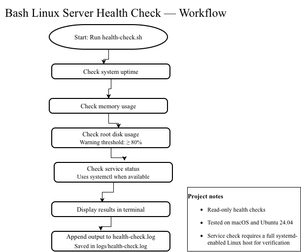
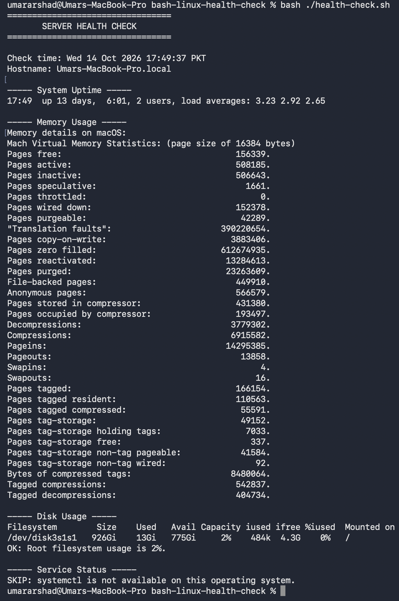
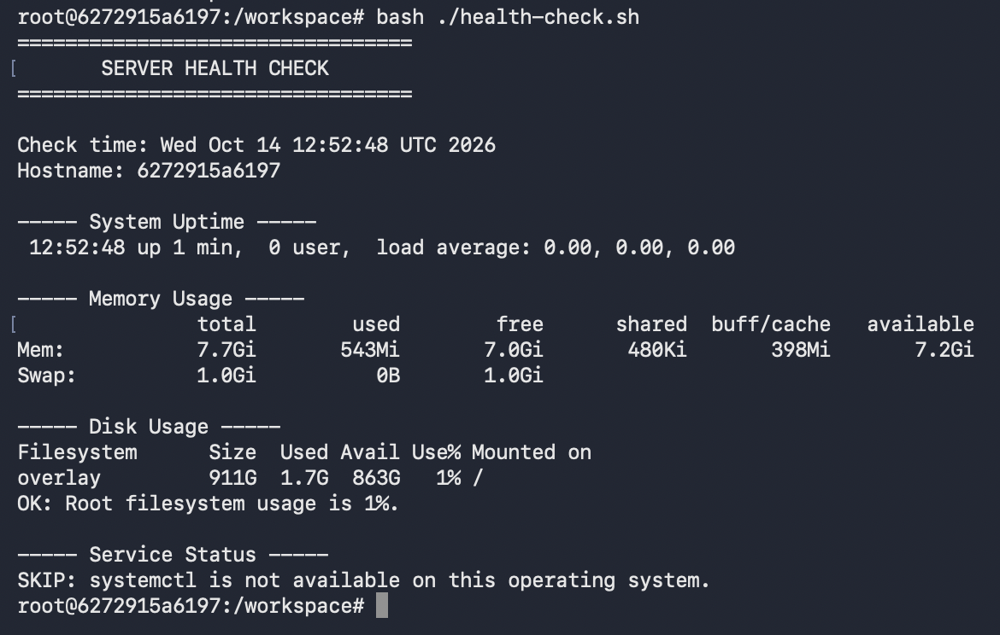
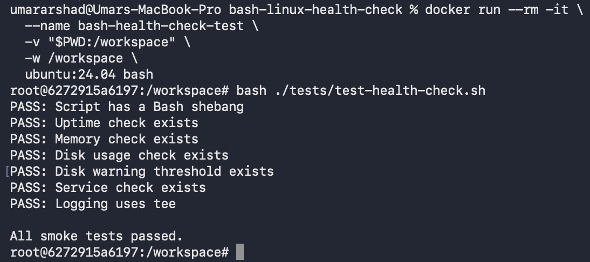

# Bash Linux Server Health Check

A read-only Bash utility that reports basic health information for Linux servers. This is a learning project focused on Bash scripting and Linux administration.

## Features

- Displays the current timestamp and hostname.
- Reports system uptime and load averages.
- Reports memory statistics.
- Displays root filesystem usage.
- Warns when root filesystem usage reaches 80% or above.
- Checks SSH service status using `systemctl` when available.
- Appends terminal output to a local log file.
- Includes smoke tests and Bash syntax checks.

## Requirements

- Bash
- Standard utilities: `date`, `hostname`, `uptime`, `df`, `awk`, and `tee`
- `free` for Linux memory reporting
- `systemctl` for Linux service checks

On macOS, the script uses `vm_stat` for memory reporting and skips the service check because `systemctl` is unavailable.

## Run the script

From the project directory:

```bash
chmod +x health-check.sh
./health-check.sh
```

## Run the smoke tests

```bash
chmod +x tests/test-health-check.sh
./tests/test-health-check.sh
```

These smoke tests verify that expected commands and sections exist in the script. They are not full functional tests.

## Check Bash syntax

```bash
bash -n health-check.sh
bash -n tests/test-health-check.sh
```

## Logging

Output is displayed in the terminal and appended to `logs/health-check.log`.

Generated log files are excluded from Git using `.gitignore`. Review logs before sharing because they can contain machine-specific information.

## Limitations

- The service check currently checks the SSH service.
- The disk warning threshold is fixed at 80%.
- Memory usage is displayed, but no memory warning threshold is implemented.
- Linux service behavior still needs to be verified on Ubuntu.
- The script reports system health; it does not automatically change settings or restart services.

## Project status

Tested locally on macOS and Ubuntu 24.04 for uptime, memory reporting, disk reporting, logging, smoke tests, and Bash syntax. Ubuntu-specific service-check behavior remains to be tested.

The SSH service check still needs verification on a full Ubuntu system where `systemctl` is available.








